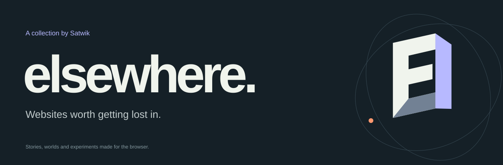
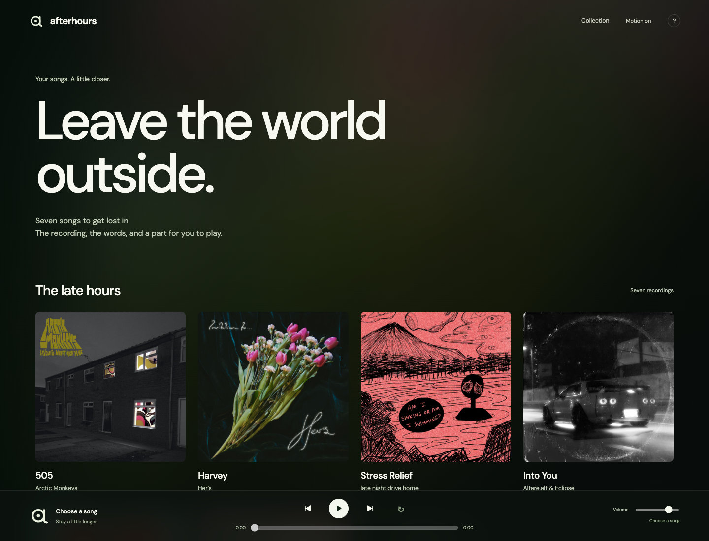
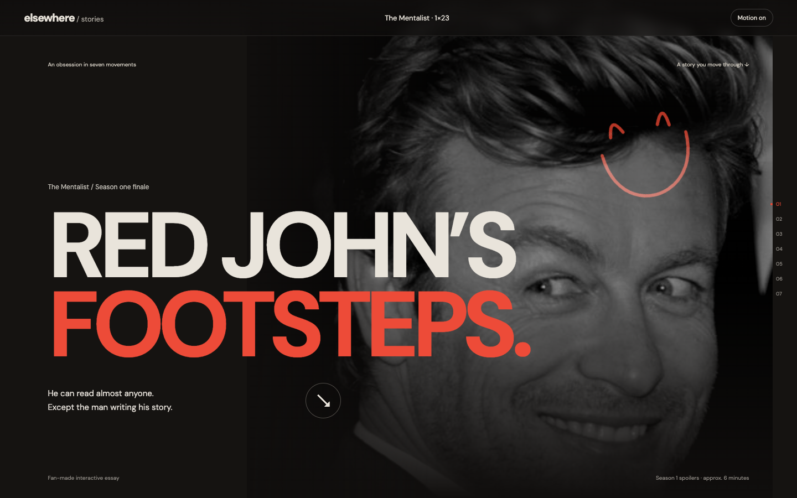
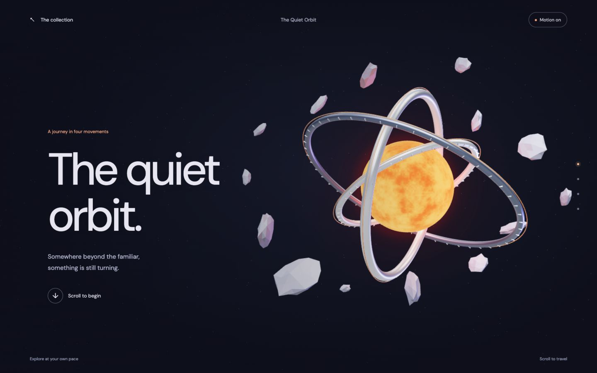

A collection of finished frontend art by **[Satwik](https://github.com/Genious07)**. Stories you scroll through, worlds you can move around, and small experiments that make the browser feel unfamiliar again.

[Open Elsewhere](https://elsewhere-experiences.vercel.app/) · [Brand assets](brand/)

> This is a public showcase, with no website source code. Afterhours, Red John’s Footsteps, The Quiet Orbit and the gallery are live. Implementation repositories remain private.

## Afterhours

A personal listening room built around seven songs. Album-coloured surroundings, lyrics that follow the recording, animated playback controls, and a studio where the pads use sounds taken from the song itself.

**Explore:** full recordings, instrumental versions, four-part mixing, eight playable sample slices, original 3D rooms and a mobile-first listening view.

**Status:** Live on Vercel. The source repository remains private.

[Open Afterhours](https://afterhours-pearl.vercel.app/) · [Project details](projects/afterhours.md) · [Brand assets](brand/afterhours/) · [Private source — owner access](https://github.com/Genious07/afterhours)

## Red John’s Footsteps

A season of obsession, told through real portraits, a playable piano, a descent into the cellar and the choice that changes Patrick Jane’s pursuit. Includes an optional, credited interactive Jane sculpture.

**Explore:** season milestones, evidence, piano testimony, scroll-controlled 3D scenes and the complete finale ending. Spoilers through season one of *The Mentalist*.

[Play Red John’s Footsteps](https://red-john-footsteps.vercel.app/) · [Credits](CREDITS.md)

## The Quiet Orbit

Leave the familiar behind. Travel through floating stone and impossible circles toward a sun of your own. Original procedural forms respond to your scroll and pointer as the camera moves through the world.

**Explore:** four chapters, reversible camera movement, sculptural lighting, replay and a reduced-motion presentation.

[Explore The Quiet Orbit](https://elsewhere-experiences.vercel.app/world) · [Credits](CREDITS.md)

## About the collection

This repository holds only the presentation: project descriptions, screenshots, demo links, logos and credits. Implementation code is maintained separately in private repositories.

New finished concepts will appear here as the collection grows.

## The identity

An **E shaped like an open doorway**: a small threshold into another place. The identity is provided as editable vectors, light and dark icons, a repository cover, and a social image.

[Brand guide](brand/README.md) · [Dark logo](brand/logo-dark.svg) · [Light logo](brand/logo-light.svg) · [Transparent mark](brand/mark.svg) · [Social image](brand/social-preview.png)

## Credits

Original Elsewhere identity and collection presentation created for Satwik. Project imagery retains its individual attribution and license; see [CREDITS.md](CREDITS.md). *The Mentalist* experience is independent fan work, not an official production.
