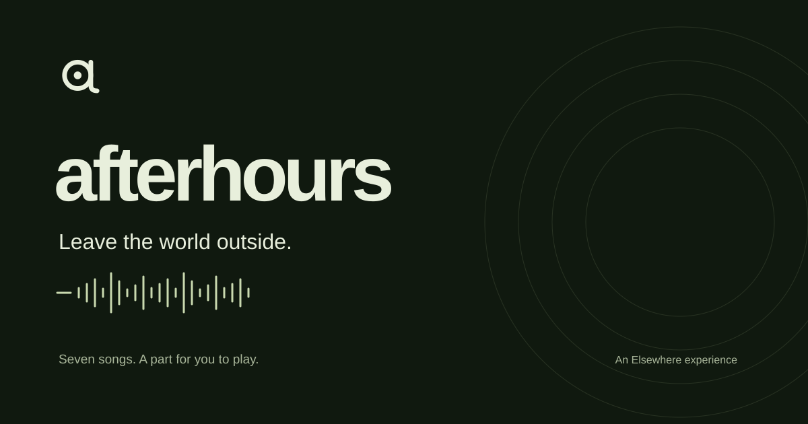

# Afterhours

A personal music experience by Satwik, part of Elsewhere.

[Open Afterhours](https://afterhours-pearl.vercel.app/)

Seven individual song routes combine album artwork, synchronized lyrics, full-recording playback, instrumental versions and a four-part stem mixer. Recorded pads replay slices of the selected accompaniment, bass or drum part, preserving the song’s sound. Each track also has an original interactive 3D room.

The listening view includes automatic lyric-follow recovery, animated SVG play/pause controls, keyboard access, reduced motion and compact phone layouts. Synthesized practice sounds are an optional, separately named mode.

## Availability

[Afterhours is live on Vercel](https://afterhours-pearl.vercel.app/). The [source repository](https://github.com/Genious07/afterhours) is private and includes the runtime assets needed for its build. That link requires access from the owner. This public showcase contains no recordings or website source.

## Identity

An original lowercase “a” made from a record and tonearm. [Light logo](../brand/afterhours/logo-light.svg), [dark logo](../brand/afterhours/logo-dark.svg), [symbol](../brand/afterhours/mark.svg), and [social cover](../brand/afterhours/social-preview.png).

Built with TypeScript, Vite, Three.js and Web Audio. The artwork visible in the preview belongs to the respective recording rights holders; the original Afterhours identity and interface were created for this project.
